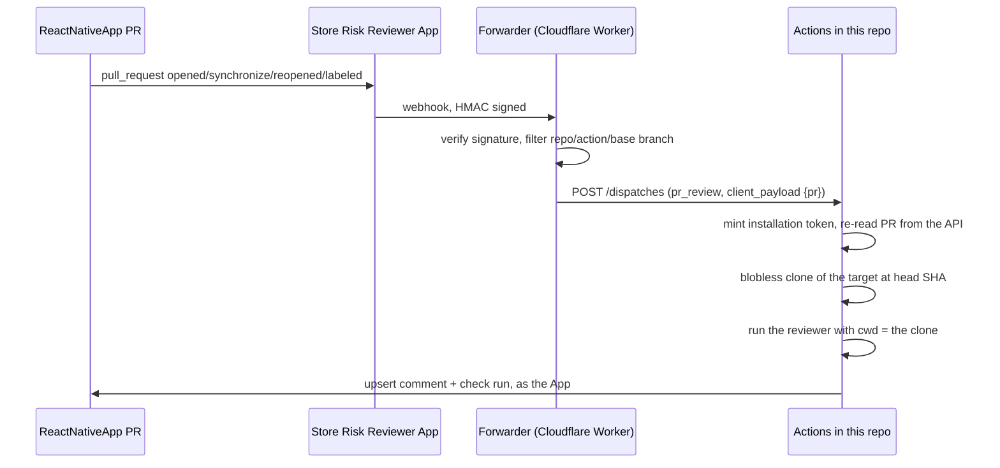

# Store Risk Reviewer

Report-only pull request bot that reviews React Native diffs against official Apple App Store
and Google Play guidelines, and posts a risk assessment back to the pull request.

It runs entirely outside the repository it reviews. `Trainerize/ReactNativeApp` needs no
workflow file, no secret, and no committed configuration: a GitHub App watches its pull
requests and this repo does the work.

## How a review happens



A GitHub App cannot start a workflow by itself, so [`worker/`](worker/src/index.ts) is the
minimal bridge between the App's webhook and `repository_dispatch`. Only the pull request
number travels in the dispatch payload; [`src/resolvePr.ts`](src/resolvePr.ts) re-reads
everything else from the API so a replayed or tampered dispatch cannot redirect a run.

## Layout

| Path | What it is |
| --- | --- |
| `src/index.ts` | Diff review entrypoint |
| `src/audit.ts` | Whole-repository audit entrypoint |
| `src/resolvePr.ts` | Reads PR facts from the API and decides whether to run |
| `src/postReport.ts` | Upserts the PR comment and creates the check run |
| `src/corpus/guidelines.jsonl` | Checked-in Apple/Google guideline excerpts |
| `src/ingestGuidelines.ts` | Refreshes that corpus from official sources |
| `worker/` | Webhook forwarder |
| `reviewer.config.json` | Target repo, base branch, audit prefix, fork approval label |

The reviewer has no runtime dependencies: it is plain TypeScript run through Node's
`--experimental-strip-types`, which needs Node 22.6 or newer.

## Two review modes

`src/resolvePr.ts` picks the mode from the head branch name:

- Branches under `auditBranchPrefix` (`ai-audit-demo/` by default) get the whole-repository
  audit, which reports pre-existing issues regardless of the diff.
- Everything else gets the diff review, which starts from the changed files but lets the
  agent read the rest of the repository for context.

`workflow_dispatch` can override the mode explicitly.

## Running it locally

```bash
nvm use 22
npm ci
npm run selftest        # no network, no API key
npm run typecheck
```

To review a real pull request you need a checkout of the target repo and a Cursor API key:

```bash
CURSOR_API_KEY=... \
AI_REVIEW_REPO_ROOT=/path/to/ReactNativeApp \
AI_REVIEW_BASE_SHA=<base sha> \
AI_REVIEW_HEAD_SHA=<head sha> \
npm run review
```

Set `AI_REVIEW_SKIP_CORPUS_REFRESH=1` to skip the guideline scrape and use the checked-in
corpus, which makes local runs much faster.

## Configuration

| Setting | Where |
| --- | --- |
| `REVIEWER_APP_ID` | Actions variable |
| `REVIEWER_APP_PRIVATE_KEY` | Actions secret |
| `CURSOR_API_KEY` | Actions secret |
| `AI_REVIEW_MODEL` | Actions variable, optional; defaults to `composer-2.5` |

Every value in `reviewer.config.json` can be overridden per run with an environment
variable: `AI_REVIEW_TARGET_REPO`, `AI_REVIEW_BASE_BRANCH`, `AI_REVIEW_AUDIT_PREFIX`,
`AI_REVIEW_FORK_LABEL`.

First-time setup, including App registration and worker deployment, is in
[`docs/SETUP.md`](docs/SETUP.md).

## Fork pull requests

The review job checks out head code while holding the Cursor key, so pull requests from forks
do not run until a maintainer applies the `ai-review:approved` label. See the security notes
in [`docs/SETUP.md`](docs/SETUP.md#security-model).
